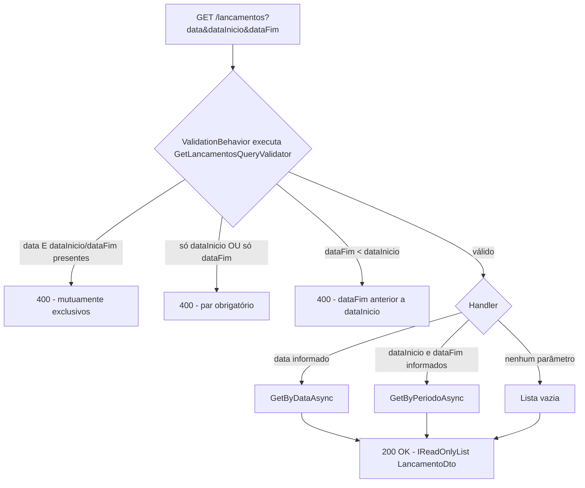
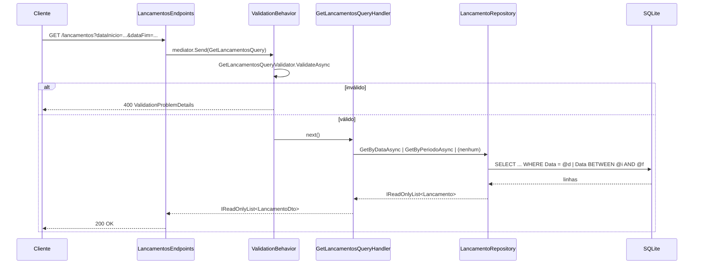

# Technical Specification: AG-2 - Suporte a intervalo de datas no endpoint de consulta de lançamentos

**Status:** Draft
**Author:** Tech Lead Agent
**Created:** 2026-10-23

---

## 🎯 Problem

### Estado atual do código

O endpoint `GET /lancamentos` está implementado em `src/Lancamentos/Lancamentos.API/Endpoints/LancamentosEndpoints.cs:45-57`:

```csharp
group.MapGet("/", async ([FromQuery] DateOnly data, IMediator mediator, CancellationToken ct) =>
{
    var result = await mediator.Send(new GetLancamentoPorDataQuery(data), ct);
    return Results.Ok(result);
})
.WithName("ListarLancamentosPorData")
...
```

- O parâmetro `data` é um `DateOnly` **não anulável e obrigatório** no binding do Minimal API. Hoje, uma chamada sem `data` já resulta em `400 Bad Request` automático do ASP.NET Core (falha de model binding), não em lista vazia. Isso é relevante porque o critério de aceite do negócio (BR-006) pede que "nenhum parâmetro informado" retorne lista vazia sem erro — ou seja, o comportamento desejado para o caso "sem parâmetros" é uma mudança de contrato em relação ao que o binding atual produziria, não uma preservação de comportamento existente. Ver decisão sobre tornar `data` anulável em `## 📋 Architectural Decisions`.
- A query MediatR correspondente, `GetLancamentoPorDataQuery(DateOnly Data) : IRequest<IReadOnlyList<LancamentoDto>>` (`Lancamentos.Application/Queries/GetLancamentoPorData/GetLancamentoPorDataQuery.cs`), é resolvida por `GetLancamentoPorDataQueryHandler`, que delega a `ILancamentoRepository.GetByDataAsync(DateOnly, CancellationToken)`.
- `ILancamentoRepository` (`Lancamentos.Domain/Repositories/ILancamentoRepository.cs`) expõe apenas `GetByIdAsync`, `GetByDataAsync`, `AddAsync`, `Remove` — **não existe** um método para consultar por intervalo.
- `LancamentoRepository.GetByDataAsync` (`Lancamentos.Infrastructure/Repositories/LancamentoRepository.cs`) filtra com `Where(l => l.Data == data)` sobre `LancamentosDbContext`, sem tracking.
- Não existe validador FluentValidation para esta query hoje — apenas comandos (`CriarLancamentoCommandValidator`) têm validator. A pipeline MediatR já registra `ValidationBehavior<,>` como *open behavior* (`Program.cs:65-70`) e `AddValidatorsFromAssembly(typeof(CriarLancamentoCommandValidator).Assembly)` escaneia todo o assembly `Lancamentos.Application` — logo, qualquer novo `AbstractValidator<T>` adicionado nesse assembly é automaticamente descoberto e aplicado, sem nova DI manual.
- Não há testes unitários para `GetLancamentoPorDataQueryHandler` hoje (`tests/Lancamentos.UnitTests/Application/` só cobre `CriarLancamentoCommandHandlerTests`) — esta feature introduz a primeira cobertura de teste para a consulta de lançamentos.
- Não há índice de banco sobre a coluna `Data` em `LancamentoConfiguration.cs` — consultas por intervalo fazem table scan sobre `TiposLancamento`/`Lancamentos` (SQLite). Isso é pré-existente e não bloqueia esta entrega (ver `## 🔒 Security Considerations` / `## 🚫 Out of Scope` para a recomendação de índice).

### Estado desejado (resumo das regras de negócio, ver `specs/AG-2/business-requirements.md`)

- `GET /lancamentos` aceita três parâmetros de query opcionais: `data`, `dataInicio`, `dataFim` (todos `yyyy-MM-dd`).
- `data` sozinho preserva o comportamento e o formato de resposta atuais (BR-001, NFR-003).
- `dataInicio` + `dataFim` retornam todos os lançamentos no intervalo, extremos inclusivos (BR-003).
- `dataFim < dataInicio` é erro de validação com mensagem clara (BR-004).
- `data` combinado com `dataInicio` e/ou `dataFim` é erro de validação (mutuamente exclusivos) (BR-005).
- `dataInicio` sem `dataFim` (e vice-versa) é erro de validação pedindo o parâmetro faltante (seção "Edge Cases" do spec de negócio).
- Nenhum parâmetro informado retorna lista vazia, sem erro (BR-006) — **isto exige tornar `data` anulável no endpoint**, mudando o binding atual.
- Formato de data inválido (ex.: `2025-6-1`) deve ser rejeitado com indicação do formato esperado — hoje isso já é responsabilidade do model binding automático do ASP.NET Core para `DateOnly`/`DateOnly?` (produz `400` via `BadHttpRequestException` → `ProblemDetails`), portanto não exige nova lógica de validação customizada.
- Swagger deve documentar os três parâmetros com descrição, formato e exemplos (BR-007).
- Resposta mantém o mesmo formato de `LancamentoDto` já usado (BR-008) — sem paginação, sem filtros adicionais (fora de escopo).

### Impacto

- **Quem é afetado:** `Lancamentos.API` (endpoint), `Lancamentos.Application` (query/handler/validator), `Lancamentos.Domain` (contrato do repositório), `Lancamentos.Infrastructure` (implementação do repositório), `Lancamentos.UnitTests` (nova cobertura). `ConsolidadoDiario` e demais bounded contexts não são afetados (fora de escopo, conforme a issue original).
- **Risco de regressão:** o principal risco é alterar a assinatura do endpoint (`DateOnly` → `DateOnly?`) e a forma como a query MediatR é construída — isso deve preservar bit-a-bit o comportamento hoje coberto implicitamente pelo caminho `data` único.

---

## 📋 Architectural Decisions

### Decisão 1 — Modelagem da query MediatR (uma query flexível vs. duas queries)

**Opção A — Estender `GetLancamentoPorDataQuery` para um único request com os três campos opcionais** (`Data`, `DataInicio`, `DataFim`), toda a validação cross-field (exclusividade mútua, obrigatoriedade em par, ordem de datas) concentrada em um único `AbstractValidator<T>` executado pelo `ValidationBehavior<,>` já existente.
- **Prós:** reusa a pipeline de validação existente (`docs/code-conventions.md` — validação de aplicação via FluentValidation, nunca inline no endpoint); um único ponto de decisão sobre qual caminho de consulta seguir; não duplica a semântica de "data única" (continua chamando `GetByDataAsync`); alinhado ao padrão "uma pasta por use case" de `docs/structure.md`, apenas evoluindo o use case existente de "consultar lançamentos" em vez de criar dois use cases paralelos para a mesma intenção de negócio.
- **Contras:** o nome atual da pasta/arquivo (`GetLancamentoPorData`) fica impreciso — precisa ser renomeado para refletir que agora cobre também intervalo.
- **Esforço:** baixo — alteração em 1 query, 1 handler, novo validator, novo método de repositório.
- **Alinhamento:** alto com `docs/structure.md` (um use case por pasta), `docs/code-conventions.md` (validação via FluentValidation, não inline), `docs/api-standards.md` (contrato de resposta inalterado).

**Opção B — Duas queries independentes (`GetLancamentoPorDataQuery` mantida + nova `GetLancamentoPorIntervaloQuery`), com o endpoint decidindo qual delas despachar e fazendo a validação de exclusividade mútua inline no endpoint.**
- **Prós:** nenhuma mudança na query existente.
- **Contras:** validação de regra de negócio (exclusividade mútua, par obrigatório) feita **inline no endpoint lambda**, o que viola explicitamente o anti-padrão documentado em `docs/code-conventions.md:76` ("nunca catch-and-translate... inline no endpoint lambda ou handler body, exceto no caso de isolamento intencional") e o princípio geral de centralizar validação via `ValidationBehavior`. Duplica a lógica de montagem de `LancamentoDto` em dois handlers.
- **Esforço:** médio.
- **Alinhamento:** baixo — quebra o padrão único de validação via pipeline FluentValidation estabelecido no projeto.
- **Rejeitada** por violar convenção explícita do projeto.

**Opção C — Normalizar sempre para intervalo no endpoint** (quando só `data` é informado, transformar em `dataInicio = dataFim = data` antes de montar a query), eliminando o branch de "data única" no handler.
- **Prós:** handler mais simples (um único caminho de repositório).
- **Contras:** a checagem de exclusividade mútua (BR-005) depende de saber se o cliente informou `data` **como parâmetro distinto** de `dataInicio`/`dataFim` — normalizar cedo demais, antes da validação, obrigaria a carregar um estado adicional ("qual parâmetro foi efetivamente informado") só para a validação, tornando o fluxo mais confuso que a Opção A. Também reintroduz risco de regressão no caminho mais usado hoje (`data` única) ao substituir uma chamada já testada implicitamente (`GetByDataAsync`) por uma nova (`GetByPeriodoAsync(d, d)`) nunca exercitada em produção.
- **Esforço:** baixo-médio.
- **Alinhamento:** médio — tecnicamente correto, mas aumenta risco de regressão sem ganho real de clareza.
- **Rejeitada** por risco de regressão desnecessário no caminho crítico de retrocompatibilidade (NFR-003).

**Decisão:** Opção A. Renomear a pasta/arquivos de `Queries/GetLancamentoPorData/` para `Queries/GetLancamentos/`, com `GetLancamentosQuery(DateOnly? Data, DateOnly? DataInicio, DateOnly? DataFim)`. O caminho `Data` continua chamando `ILancamentoRepository.GetByDataAsync` sem alterações, preservando bit-a-bit o comportamento testado hoje.

### Decisão 2 — Onde validar as regras cross-field (exclusividade mútua, par obrigatório, ordem de datas)

**Opção A — FluentValidation `AbstractValidator<GetLancamentosQuery>` com `RuleFor(x => x).Must(...)` e `RuleFor(x => x.Campo).When(...)`.**
- **Prós:** único mecanismo de validação de aplicação usado no projeto hoje (`docs/tech.md` lista FluentValidation como a lib de validação); erros surgem como `ValidationProblemDetails` (400) via `ValidationExceptionHandler` já existente — mesmo formato de erro em toda a API (`docs/api-standards.md`); testável isoladamente sem subir o pipeline HTTP.
- **Contras:** regras cross-field em FluentValidation são um pouco mais verbosas que validação imperativa simples.
- **Esforço:** baixo.
- **Alinhamento:** alto.

**Opção B — Validação manual no handler (`if` + `throw ArgumentException`).**
- **Contras:** `ArgumentException` é reservado para invariantes de **domínio** lançadas por agregados/VOs (`docs/code-conventions.md:63-74`), não para validação de entrada de aplicação; não produziria o formato `ValidationProblemDetails` padrão (400) a menos que se crie um novo `IExceptionHandler`, divergindo do padrão único de erro de validação já estabelecido.
- **Esforço:** baixo.
- **Alinhamento:** baixo.
- **Rejeitada** por desviar do padrão de erro 400 único já estabelecido.

**Decisão:** Opção A — um `GetLancamentosQueryValidator : AbstractValidator<GetLancamentosQuery>` na mesma pasta `Queries/GetLancamentos/`, descoberto automaticamente por `AddValidatorsFromAssembly` (nenhuma mudança de DI necessária).

### Decisão 3 — Tornar `data` anulável no endpoint para suportar "nenhum parâmetro" (BR-006)

**Opção A — `DateOnly? data` (nullable) nos três parâmetros do endpoint**, repassando `null`s para `GetLancamentosQuery`; handler retorna lista vazia quando nenhum dos três tem valor.
- **Prós:** única forma de diferenciar "não informado" de um valor específico sem introduzir um sentinel value; alinhado ao uso de `T?` já estabelecido em `docs/code-conventions.md:50` para "DTOs/results que podem não existir".
- **Contras:** muda a assinatura do endpoint (hoje `DateOnly data` obrigatório); clientes que hoje dependem do `400` automático para chamadas sem `data` passam a receber `200` com lista vazia — mudança de comportamento explicitamente pedida por BR-006, documentada aqui para visibilidade do Product Owner.
- **Esforço:** baixo.
- **Alinhamento:** alto com BR-006 e com o padrão de nullable do projeto.

**Decisão:** Opção A. O comportamento de "sem parâmetros ⇒ 400" nunca foi um contrato formalmente documentado (não consta em `docs/api-standards.md` nem em README) — é um efeito colateral do binding de um parâmetro obrigatório, não uma regra de negócio. BR-006 substitui esse efeito colateral por um comportamento explícito e testado.

### Decisão 4 — Novo método de repositório para intervalo

**Opção A — Adicionar `Task<IReadOnlyList<Lancamento>> GetByPeriodoAsync(DateOnly inicio, DateOnly fim, CancellationToken cancellationToken = default)` em `ILancamentoRepository`/`LancamentoRepository`, filtrando `Where(l => l.Data >= inicio && l.Data <= fim)`.**
- **Prós:** segue a Interface Segregation já praticada (`docs/structure.md:120` — "uma interface de repositório por agregado", métodos de consulta explícitos por critério); mantém `GetByDataAsync` intocado (zero risco de regressão no caminho único); espelha a assinatura existente (`CancellationToken cancellationToken = default`, `AsNoTracking()`).
- **Contras:** nenhum relevante.
- **Esforço:** baixo.
- **Alinhamento:** alto.

**Decisão:** Opção A.

---

## 🔄 Decision Flow



---

## 🏗️ Architecture and Implementation

### Padrão arquitetural

Clean Architecture + CQRS via MediatR, inalterado: `API` (endpoint + binding) → `Application` (query + handler + validator, pipeline `ValidationBehavior<,>`) → `Domain` (contrato de repositório) → `Infrastructure` (implementação EF Core). Nenhuma camada nova é introduzida; a mudança é inteiramente dentro do bounded context `Lancamentos`.

### Componentes-chave (caminhos reais)

| Camada | Arquivo | Mudança |
|---|---|---|
| API | `src/Lancamentos/Lancamentos.API/Endpoints/LancamentosEndpoints.cs` | Assinatura do `MapGet("/")` passa a aceitar `data`, `dataInicio`, `dataFim` opcionais; `WithOpenApi` documenta os 3 parâmetros |
| Application | `src/Lancamentos/Lancamentos.Application/Queries/GetLancamentoPorData/` → renomear para `Queries/GetLancamentos/GetLancamentosQuery.cs` | Query ganha `DateOnly? Data`, `DateOnly? DataInicio`, `DateOnly? DataFim` |
| Application | `Queries/GetLancamentos/GetLancamentosQueryHandler.cs` | Branch por qual(is) parâmetro(s) está(ão) presente(s) |
| Application | `Queries/GetLancamentos/GetLancamentosQueryValidator.cs` (novo) | Regras cross-field (exclusividade, par obrigatório, ordem) |
| Domain | `src/Lancamentos/Lancamentos.Domain/Repositories/ILancamentoRepository.cs` | Novo método `GetByPeriodoAsync` |
| Infrastructure | `src/Lancamentos/Lancamentos.Infrastructure/Repositories/LancamentoRepository.cs` | Implementação de `GetByPeriodoAsync` |
| Tests | `tests/Lancamentos.UnitTests/Application/GetLancamentosQueryHandlerTests.cs` (novo) | Cobertura dos cenários do BR-001 a BR-006 |
| Tests | `tests/Lancamentos.UnitTests/Application/GetLancamentosQueryValidatorTests.cs` (novo) | Cobertura das regras de validação cross-field |

Nenhuma mudança de DI é necessária: `AddValidatorsFromAssembly(typeof(CriarLancamentoCommandValidator).Assembly)` (`Lancamentos.API/Program.cs:59`) já escaneia o assembly `Lancamentos.Application` inteiro, e `AddMediatR(cfg => cfg.RegisterServicesFromAssembly(typeof(CriarLancamentoCommandHandler).Assembly))` (`Program.cs:67`) já registra todos os handlers desse assembly — o novo validator e o novo handler são descobertos automaticamente.

### Fluxo de dados



### Implementação — Domain

```csharp
// src/Lancamentos/Lancamentos.Domain/Repositories/ILancamentoRepository.cs
public interface ILancamentoRepository
{
    Task<Lancamento?> GetByIdAsync(Guid id, CancellationToken cancellationToken = default);
    Task<IReadOnlyList<Lancamento>> GetByDataAsync(DateOnly data, CancellationToken cancellationToken = default);
    Task<IReadOnlyList<Lancamento>> GetByPeriodoAsync(DateOnly inicio, DateOnly fim, CancellationToken cancellationToken = default);
    Task AddAsync(Lancamento lancamento, CancellationToken cancellationToken = default);
    void Remove(Lancamento lancamento);
}
```

### Implementação — Infrastructure

```csharp
// src/Lancamentos/Lancamentos.Infrastructure/Repositories/LancamentoRepository.cs
public async Task<IReadOnlyList<Lancamento>> GetByPeriodoAsync(
    DateOnly inicio, DateOnly fim, CancellationToken cancellationToken = default) =>
    await _context.Lancamentos
        .Where(l => l.Data >= inicio && l.Data <= fim)
        .AsNoTracking()
        .ToListAsync(cancellationToken);
```

### Implementação — Application (query)

```csharp
// src/Lancamentos/Lancamentos.Application/Queries/GetLancamentos/GetLancamentosQuery.cs
using Lancamentos.Application.DTOs;
using MediatR;

namespace Lancamentos.Application.Queries.GetLancamentos;

public sealed record GetLancamentosQuery(
    DateOnly? Data,
    DateOnly? DataInicio,
    DateOnly? DataFim) : IRequest<IReadOnlyList<LancamentoDto>>;
```

### Implementação — Application (validator)

```csharp
// src/Lancamentos/Lancamentos.Application/Queries/GetLancamentos/GetLancamentosQueryValidator.cs
using FluentValidation;

namespace Lancamentos.Application.Queries.GetLancamentos;

public sealed class GetLancamentosQueryValidator : AbstractValidator<GetLancamentosQuery>
{
    public GetLancamentosQueryValidator()
    {
        RuleFor(x => x)
            .Must(x => !(x.Data.HasValue && (x.DataInicio.HasValue || x.DataFim.HasValue)))
            .WithName("data")
            .WithMessage("Os parâmetros 'data' e 'dataInicio'/'dataFim' são mutuamente exclusivos. Informe apenas um dos modos de consulta.");

        RuleFor(x => x.DataFim)
            .NotNull()
            .When(x => x.DataInicio.HasValue && !x.Data.HasValue)
            .WithMessage("O parâmetro 'dataFim' é obrigatório quando 'dataInicio' for informado.");

        RuleFor(x => x.DataInicio)
            .NotNull()
            .When(x => x.DataFim.HasValue && !x.Data.HasValue)
            .WithMessage("O parâmetro 'dataInicio' é obrigatório quando 'dataFim' for informado.");

        RuleFor(x => x.DataFim)
            .GreaterThanOrEqualTo(x => x.DataInicio!.Value)
            .When(x => x.DataInicio.HasValue && x.DataFim.HasValue)
            .WithMessage("O parâmetro 'dataFim' não pode ser anterior a 'dataInicio'.");
    }
}
```

### Implementação — Application (handler)

```csharp
// src/Lancamentos/Lancamentos.Application/Queries/GetLancamentos/GetLancamentosQueryHandler.cs
using Lancamentos.Application.DTOs;
using Lancamentos.Domain.Entities;
using Lancamentos.Domain.Repositories;
using MediatR;

namespace Lancamentos.Application.Queries.GetLancamentos;

public sealed class GetLancamentosQueryHandler
    : IRequestHandler<GetLancamentosQuery, IReadOnlyList<LancamentoDto>>
{
    private readonly ILancamentoRepository _repository;

    public GetLancamentosQueryHandler(ILancamentoRepository repository)
        => _repository = repository;

    public async Task<IReadOnlyList<LancamentoDto>> Handle(
        GetLancamentosQuery request,
        CancellationToken cancellationToken)
    {
        IReadOnlyList<Lancamento> lancamentos;

        if (request.Data.HasValue)
            lancamentos = await _repository.GetByDataAsync(request.Data.Value, cancellationToken);
        else if (request.DataInicio.HasValue && request.DataFim.HasValue)
            lancamentos = await _repository.GetByPeriodoAsync(request.DataInicio.Value, request.DataFim.Value, cancellationToken);
        else
            return Array.Empty<LancamentoDto>();

        return lancamentos
            .Select(l => new LancamentoDto(l.Id, l.Tipo, l.Valor.Valor, l.Descricao, l.Data, l.CriadoEm))
            .ToList()
            .AsReadOnly();
    }
}
```

### Implementação — API (endpoint + Swagger)

```csharp
// src/Lancamentos/Lancamentos.API/Endpoints/LancamentosEndpoints.cs
group.MapGet("/", async (
    [FromQuery] DateOnly? data,
    [FromQuery] DateOnly? dataInicio,
    [FromQuery] DateOnly? dataFim,
    IMediator mediator,
    CancellationToken ct) =>
{
    var result = await mediator.Send(new GetLancamentosQuery(data, dataInicio, dataFim), ct);
    return Results.Ok(result);
})
.WithName("ListarLancamentos")
.WithSummary("Lista lançamentos por data única ou por intervalo de datas")
.WithDescription(
    "Use 'data' para consultar um único dia (comportamento original, mantido por retrocompatibilidade) " +
    "OU 'dataInicio' + 'dataFim' para consultar um período (extremos inclusivos). " +
    "Os dois modos são mutuamente exclusivos. Sem nenhum parâmetro, retorna lista vazia.")
.Produces<IReadOnlyList<LancamentoDto>>(StatusCodes.Status200OK)
.ProducesProblem(StatusCodes.Status400BadRequest)
.WithOpenApi(op =>
{
    op.Parameters[0].Description = "Data única no formato yyyy-MM-dd (ex: 2025-06-01). Mutuamente exclusivo com dataInicio/dataFim.";
    op.Parameters[1].Description = "Início do intervalo no formato yyyy-MM-dd (ex: 2025-06-01). Requer dataFim.";
    op.Parameters[2].Description = "Fim do intervalo no formato yyyy-MM-dd (ex: 2025-06-30). Requer dataInicio; não pode ser anterior a dataInicio.";
    return op;
});
```

Namespace do endpoint deve trocar o `using Lancamentos.Application.Queries.GetLancamentoPorData;` por `using Lancamentos.Application.Queries.GetLancamentos;`.

### Nota de performance (não bloqueante para esta entrega)

`LancamentoConfiguration.cs` não define índice sobre a coluna `Data`. Consultas por intervalo (NFR-001) sobre volumes grandes se beneficiariam de `builder.HasIndex(l => l.Data);`. Como isso é uma melhoria de infraestrutura de dados independente da feature e o projeto usa `EnsureCreatedAsync()` (sem migrations), a decisão é **não incluir** nesta entrega — ver `## 🚫 Out of Scope`.

---

## ✅ Testing, Security, and Definition of Done

## ✅ Testing Strategy

Segue `docs/testing-standards.md`: xUnit + FluentAssertions + NSubstitute, testes `sealed class`, nomenclatura `{Metodo}_{Cenario}_{ResultadoEsperado}` em português, AAA sem comentários de seção, mocks via `Substitute.For<T>()`, sem banco real. Novos arquivos em `tests/Lancamentos.UnitTests/Application/`.

### `GetLancamentosQueryHandlerTests.cs`

```csharp
public sealed class GetLancamentosQueryHandlerTests
{
    private readonly ILancamentoRepository _repository = Substitute.For<ILancamentoRepository>();
    private readonly GetLancamentosQueryHandler _handler;

    public GetLancamentosQueryHandlerTests()
        => _handler = new GetLancamentosQueryHandler(_repository);

    [Fact]
    public async Task Handle_ComDataUnica_DeveChamarGetByDataAsync()
    {
        var data = DateOnly.FromDateTime(DateTime.Today);
        var query = new GetLancamentosQuery(data, null, null);
        _repository.GetByDataAsync(data, Arg.Any<CancellationToken>())
            .Returns(new List<Lancamento>());

        await _handler.Handle(query, CancellationToken.None);

        await _repository.Received(1).GetByDataAsync(data, Arg.Any<CancellationToken>());
        await _repository.DidNotReceive().GetByPeriodoAsync(Arg.Any<DateOnly>(), Arg.Any<DateOnly>(), Arg.Any<CancellationToken>());
    }

    [Fact]
    public async Task Handle_ComIntervaloValido_DeveChamarGetByPeriodoAsyncERetornarTodosOsLancamentos()
    {
        var inicio = new DateOnly(2025, 6, 1);
        var fim = new DateOnly(2025, 6, 3);
        var lancamentos = new List<Lancamento>
        {
            Lancamento.Criar(TipoLancamento.Credito, 100m, "Dia 1", inicio),
            Lancamento.Criar(TipoLancamento.Debito, 50m, "Dia 3", fim),
        };
        _repository.GetByPeriodoAsync(inicio, fim, Arg.Any<CancellationToken>()).Returns(lancamentos);

        var result = await _handler.Handle(new GetLancamentosQuery(null, inicio, fim), CancellationToken.None);

        result.Should().HaveCount(2);
    }

    [Fact]
    public async Task Handle_ComIntervaloDeUmUnicoDia_DeveRetornarApenasAqueleDia()
    {
        var dia = new DateOnly(2025, 6, 2);
        _repository.GetByPeriodoAsync(dia, dia, Arg.Any<CancellationToken>())
            .Returns(new List<Lancamento> { Lancamento.Criar(TipoLancamento.Credito, 10m, "X", dia) });

        var result = await _handler.Handle(new GetLancamentosQuery(null, dia, dia), CancellationToken.None);

        result.Should().ContainSingle(l => l.Data == dia);
    }

    [Fact]
    public async Task Handle_ComIntervaloSemLancamentos_DeveRetornarListaVazia()
    {
        _repository.GetByPeriodoAsync(Arg.Any<DateOnly>(), Arg.Any<DateOnly>(), Arg.Any<CancellationToken>())
            .Returns(new List<Lancamento>());

        var result = await _handler.Handle(
            new GetLancamentosQuery(null, new DateOnly(2025, 7, 1), new DateOnly(2025, 7, 31)),
            CancellationToken.None);

        result.Should().BeEmpty();
    }

    [Fact]
    public async Task Handle_SemNenhumParametro_DeveRetornarListaVaziaSemConsultarRepositorio()
    {
        var result = await _handler.Handle(new GetLancamentosQuery(null, null, null), CancellationToken.None);

        result.Should().BeEmpty();
        await _repository.DidNotReceive().GetByDataAsync(Arg.Any<DateOnly>(), Arg.Any<CancellationToken>());
        await _repository.DidNotReceive().GetByPeriodoAsync(Arg.Any<DateOnly>(), Arg.Any<DateOnly>(), Arg.Any<CancellationToken>());
    }
}
```

### `GetLancamentosQueryValidatorTests.cs`

```csharp
public sealed class GetLancamentosQueryValidatorTests
{
    private readonly GetLancamentosQueryValidator _validator = new();

    [Fact]
    public async Task Validate_ComIntervaloValido_NaoDeveTerErros()
    {
        var result = await _validator.ValidateAsync(
            new GetLancamentosQuery(null, new DateOnly(2025, 6, 1), new DateOnly(2025, 6, 3)));

        result.IsValid.Should().BeTrue();
    }

    [Fact]
    public async Task Validate_ComDataFimAnteriorADataInicio_DeveRetornarErro()
    {
        var result = await _validator.ValidateAsync(
            new GetLancamentosQuery(null, new DateOnly(2025, 6, 10), new DateOnly(2025, 6, 1)));

        result.IsValid.Should().BeFalse();
        result.Errors.Should().Contain(e => e.ErrorMessage.Contains("dataFim"));
    }

    [Theory]
    [InlineData("2025-06-01", null)]
    [InlineData(null, "2025-06-01")]
    public async Task Validate_ComApenasUmDosParametrosDeIntervalo_DeveRetornarErro(string? inicio, string? fim)
    {
        var query = new GetLancamentosQuery(
            null,
            inicio is null ? null : DateOnly.Parse(inicio),
            fim is null ? null : DateOnly.Parse(fim));

        var result = await _validator.ValidateAsync(query);

        result.IsValid.Should().BeFalse();
    }

    [Fact]
    public async Task Validate_ComDataEDataInicioSimultaneos_DeveRetornarErroDeExclusividade()
    {
        var result = await _validator.ValidateAsync(
            new GetLancamentosQuery(new DateOnly(2025, 6, 1), new DateOnly(2025, 6, 1), null));

        result.IsValid.Should().BeFalse();
        result.Errors.Should().Contain(e => e.ErrorMessage.Contains("mutuamente exclusivos"));
    }

    [Fact]
    public async Task Validate_SemNenhumParametro_NaoDeveTerErros()
    {
        var result = await _validator.ValidateAsync(new GetLancamentosQuery(null, null, null));

        result.IsValid.Should().BeTrue();
    }
}
```

**Cobertura mapeada para os critérios de aceite (seção 5 do spec de negócio):** intervalo válido, intervalo de um dia, intervalo sem lançamentos, `dataFim < dataInicio`, combinação inválida com `data`, par incompleto (`dataInicio` sem `dataFim` e vice-versa), nenhum parâmetro informado. O cenário de regressão de autenticação (token inválido) já é coberto estruturalmente por `.RequireAuthorization()` no grupo de rotas e não exige novo teste de unidade (é comportamento de framework, não de código da aplicação).

---

## 🔒 Security Considerations

- **Autenticação/Autorização:** inalterado — o novo parâmetro continua sob o mesmo `group.RequireAuthorization()` e `group.RequireRateLimiting("api")` do grupo `/lancamentos` (`LancamentosEndpoints.cs:16-19`). Nenhuma nova rota é criada, então nenhuma nova regra de autorização precisa ser declarada.
- **Validação de entrada:** `dataInicio`/`dataFim`/`data` são `DateOnly?` — o model binding do ASP.NET Core já rejeita formatos inválidos antes mesmo de chegar ao MediatR, retornando 400 automaticamente (mesmo comportamento hoje aplicado ao parâmetro `data`). As regras de negócio (exclusividade, ordem, par obrigatório) são validadas via FluentValidation antes do handler, nunca compostas diretamente em SQL por concatenação — a consulta usa EF Core com parâmetros (`Where(l => l.Data >= inicio && l.Data <= fim)`), sem risco de injeção.
- **Exposição de dados:** nenhuma mudança no formato de `LancamentoDto` (BR-008) — não há exposição de campos novos ou sensíveis.
- **Negação de serviço por intervalo extenso:** um intervalo muito grande (ex: 10 anos) sem paginação pode gerar uma resposta grande. Isso já é uma limitação aceita e documentada do contrato atual (`docs/api-standards.md:107` — "nenhuma envelope de paginação existe hoje") e paginação está explicitamente fora de escopo desta entrega (ver issue original e `## 🚫 Out of Scope`). O rate limiter existente (`"api"`, 100 permits/s) já mitiga abuso por volume de chamadas, não por tamanho de resposta individual.
- **Logs:** nenhum dado sensível (JWT, senha) é logado; eventuais falhas de validação seguem o padrão existente de `ValidationExceptionHandler`, que não loga o payload bruto da requisição.

---

## ✅ Definition of Done

**Implementação:**
- [ ] `ILancamentoRepository`/`LancamentoRepository` ganham `GetByPeriodoAsync`
- [ ] Pasta `Queries/GetLancamentoPorData/` renomeada/migrada para `Queries/GetLancamentos/` com `GetLancamentosQuery` aceitando `Data`, `DataInicio`, `DataFim` opcionais
- [ ] `GetLancamentosQueryValidator` cobre: exclusividade mútua, par obrigatório, ordem de datas
- [ ] `GetLancamentosQueryHandler` despacha para `GetByDataAsync`, `GetByPeriodoAsync` ou lista vazia
- [ ] `LancamentosEndpoints.cs` atualizado: `data`, `dataInicio`, `dataFim` como `DateOnly?`, `WithOpenApi` com descrições e exemplos para os 3 parâmetros
- [ ] Nenhuma mudança em `ConsolidadoDiario` ou em outros endpoints

**Testes:**
- [ ] `GetLancamentosQueryHandlerTests` cobrindo os 5 cenários mapeados acima
- [ ] `GetLancamentosQueryValidatorTests` cobrindo todas as combinações inválidas
- [ ] `dotnet test fluxocaixa.sln` passa sem falhas

**Qualidade:**
- [ ] Sem XML doc comments adicionados (convenção do projeto)
- [ ] Mensagens de erro em português, claras, consistentes com o estilo existente (`"A descrição é obrigatória."` etc.)
- [ ] Nenhum `catch (Exception)` genérico introduzido fora do caso já sancionado (`AtualizarConsolidadoEventHandler`)

**Documentação:**
- [ ] Swagger UI (`/swagger`) exibe `dataInicio`/`dataFim` com descrição, formato `yyyy-MM-dd` e exemplos (BR-007)
- [ ] README.md — se a seção "Endpoints da API" documentar explicitamente `GET /lancamentos?data=...`, atualizar para refletir os novos parâmetros (verificar conteúdo atual do README antes de editar)

---

## 🚫 Out of Scope

- Paginação dos resultados da lista de lançamentos (tratar em task separada, conforme a própria issue original e BR do negócio).
- Qualquer alteração no endpoint `GET /consolidado/{data}` ou no bounded context `ConsolidadoDiario`.
- Filtros adicionais (tipo de lançamento, valor mínimo/máximo, descrição).
- Exportação de resultados (CSV/Excel/PDF).
- Alterações no mecanismo de autenticação/autorização.
- Alteração no formato de resposta de `LancamentoDto`.
- Adição de índice de banco (`HasIndex(l => l.Data)`) sobre a coluna `Data` — recomendado como melhoria futura de performance (NFR-001), mas não incluído nesta entrega por ser uma decisão de infraestrutura de dados independente, sem migrations configuradas no projeto hoje.
- Versionamento de API (`/v1/lancamentos`) — não introduzido; a mudança é aditiva (novos parâmetros opcionais) e não quebra o contrato existente.

---

## 📚 References

- `docs/tech.md` — stack .NET 8, MediatR, FluentValidation, EF Core/SQLite
- `docs/structure.md` — Clean Architecture por bounded context, padrão "uma pasta por use case", namespaces espelhando pastas
- `docs/api-standards.md` — convenções de rota (`GET /lancamentos?data=yyyy-MM-dd`), formato de erro (`ValidationProblemDetails` 400), ausência de paginação, autenticação JWT Bearer
- `docs/testing-standards.md` — xUnit + FluentAssertions + NSubstitute, nomenclatura `{Metodo}_{Cenario}_{Resultado}`, mocking de toda dependência externa do handler
- `docs/code-conventions.md` — validação via FluentValidation/`ValidationBehavior`, proibição de `catch (Exception)` genérico fora do caso sancionado, `T?` para valores opcionais, sem XML doc comments
- `specs/AG-2/business-requirements.md` — BR-001 a BR-008, NFR-001 a NFR-005, cenários Gherkin (seção 5), edge cases (seção 7), fora de escopo (seção 8)
- Issue original AG-2 — "Adicionar suporte a intervalo de datas no endpoint de consulta de lançamentos"
- `src/Lancamentos/Lancamentos.API/Endpoints/LancamentosEndpoints.cs`, `Lancamentos.Application/Queries/GetLancamentoPorData/*`, `Lancamentos.Domain/Repositories/ILancamentoRepository.cs`, `Lancamentos.Infrastructure/Repositories/LancamentoRepository.cs` — código existente analisado para esta especificação
