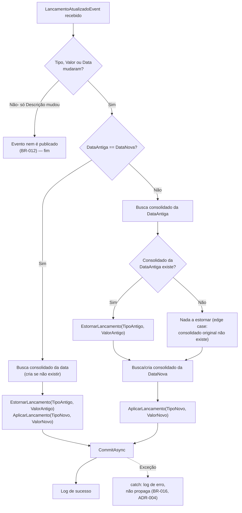
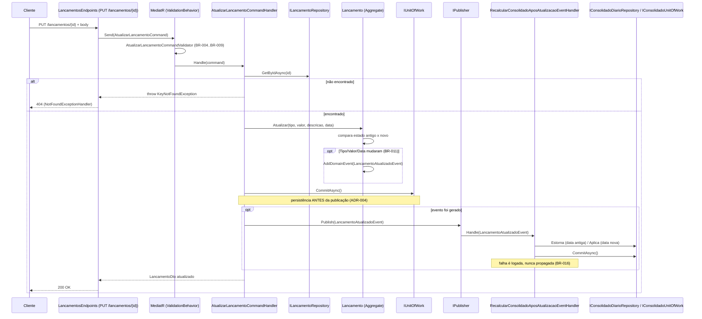

# Technical Specification: AG-3 - Permitir atualização de um Lançamento existente

**Status:** Draft
**Author:** Tech Lead Agent
**Created:** 2026-10-29

---

## 🎯 Problem

### Estado Atual

- `Lancamentos.API` expõe apenas `POST /lancamentos` (criar), `GET /lancamentos/{id:guid}`, `GET /lancamentos?data=`, e `DELETE /lancamentos/{id:guid}` (remover) — ver [api-standards.md](../../docs/api-standards.md). Não existe rota `PUT`/`PATCH`; `api-standards.md` registra explicitamente "não há caso de uso de atualização hoje".
- O Aggregate Root `Lancamento` (`src/Lancamentos/Lancamentos.Domain/Entities/Lancamento.cs`) expõe apenas `Criar(...)` (factory estático) e `Remover()`. Não existe nenhum método de mutação de estado pós-criação.
- A sincronização com o Consolidado Diário acontece via Domain Events in-process (MediatR `IPublisher`/`INotificationHandler`, ver [ADR-004](../../docs/adr/ADR-004-domain-events-desacoplamento.md)):
  - `LancamentoCriadoEvent` → `AtualizarConsolidadoEventHandler.AplicarLancamento(tipo, valor)` na data do evento.
  - `LancamentoRemovidoEvent` → `RecalcularConsolidadoEventHandler.EstornarLancamento(tipo, valor)` na data do evento.
  - Não existe um terceiro evento/handler para "atualização"; hoje a única forma de corrigir um lançamento é removê-lo (gerando `LancamentoRemovidoEvent`) e criar um novo (gerando `LancamentoCriadoEvent`) — dois registros de auditoria sem vínculo entre si, e dois IDs distintos (perda de rastreabilidade, conforme BR vigentes no `specs/AG-3/business-requirements.md`).
- `CriarLancamentoCommandValidator` já implementa as regras de validação de `Tipo`, `Valor` (>0, ≤ R$1bi, ≤2 casas decimais), `Descricao` (obrigatória, ≤255 chars) e `Data` (não futura) — estas são exatamente as regras BR-004 a BR-009 da especificação de negócio, reaproveitáveis para a atualização.

### Estado Desejado

- Um novo endpoint `PUT /lancamentos/{id:guid}` permite atualizar **todos** os campos editáveis de um lançamento existente (`Tipo`, `Valor`, `Descricao`, `Data`) em uma única operação atômica, preservando `Id` e `CriadoEm` (BR-002, BR-003).
- Atualizações parciais não são suportadas — todos os campos devem ser enviados (BR-010), consistente com a semântica de substituição total do verbo `PUT`.
- O Consolidado Diário é recalculado automaticamente apenas quando `Tipo`, `Valor` ou `Data` mudam (BR-011/BR-012):
  - Mesma data, tipo/valor alterados → estorna os valores antigos e aplica os novos na mesma data (BR-014).
  - Data alterada → estorna o lançamento no consolidado da data original (se existir) e aplica o lançamento (com os novos dados) no consolidado da nova data (BR-013).
  - Apenas descrição alterada → nenhum recálculo de consolidado ocorre (BR-012).
- Uma falha no recálculo do consolidado não impede nem reverte a persistência do lançamento atualizado — mesma garantia de resiliência já estabelecida pelo ADR-004 para criação/remoção (BR-016).
- A operação exige autenticação (BR-015) e está sujeita ao mesmo rate limiting do grupo `/lancamentos` (NFR "Taxa de Requisições").

### Impacto de Negócio

- Elimina a necessidade de "remover + recriar" para corrigir erros de digitação, preservando o `Id` e o `CriadoEm` originais do lançamento — melhora a rastreabilidade histórica (ver Business Requirements §2 "Estado Desejado").
- Reduz o risco de saldo consolidado incorreto por lançamentos nunca corrigidos.
- Zero impacto em `ConsolidadoDiario.API` como processo — a nova lógica de recálculo roda dentro do processo `Lancamentos.API`, que já hospeda ambos os `DbContext`s e handlers dos dois bounded contexts (ver [tech.md](../../docs/tech.md) "Constraints").

---

## 📋 Architectural Decisions

### Decisão 1 — Verbo HTTP e rota

| Opção | Descrição | Prós | Contras | Esforço | Alinhamento com docs |
|---|---|---|---|---|---|
| **A — `PUT /lancamentos/{id:guid}`** | Substituição total do recurso, corpo com todos os campos | Semântica REST correta para "todos os campos obrigatórios" (BR-010); idempotente; rota já segue o padrão `{id:guid}` usado em `GET`/`DELETE` | É o primeiro uso de `PUT` no projeto — `api-standards.md` precisa ser atualizado para registrar o novo caso de uso (não é mais verdade que "não há update") | Baixo | Alinhado a [api-standards.md §REST Conventions](../../docs/api-standards.md) — PUT é a lacuna documentada, não uma invenção |
| B — `PATCH /lancamentos/{id:guid}` | Atualização parcial por convenção HTTP | Nenhuma vantagem real aqui | Semântica de PATCH é "parcial"; BR-010 exige envio de todos os campos — usar PATCH para uma substituição total é enganoso | Baixo | Diverge do BR-010 |
| C — `POST /lancamentos/{id}/atualizar` | Rota de ação customizada | Evita introduzir um verbo novo | Verbo-na-URL não existe em nenhuma rota atual (`api-standards.md` não documenta esse estilo); quebra a convenção REST do restante da API | Baixo | Não alinhado |

**Decisão:** Opção A (`PUT /lancamentos/{id:guid}`). Resposta: `200 OK` com o `LancamentoDto` atualizado (não `201 Created`, pois o recurso já existe). Erros seguem os mesmos shapes já documentados: `400` via `ValidationProblemDetails` (`ValidationExceptionHandler`), `404` via `KeyNotFoundException` → `NotFoundExceptionHandler` (reaproveitando o padrão já recomendado em [api-standards.md §Error — not found](../../docs/api-standards.md) para não introduzir uma terceira forma de 404), `401` via `.RequireAuthorization()` do grupo.

**Trade-off assumido:** este é tecnicamente uma mudança em `api-standards.md` (passa a haver um "PUT" documentado); isso é esperado e deve ser refletido no documento de steering como parte desta feature, não como uma inconsistência a esconder.

---

### Decisão 2 — Como propagar a atualização para o Consolidado Diário

| Opção | Descrição | Prós | Contras | Esforço | Alinhamento com docs |
|---|---|---|---|---|---|
| **A — Novo evento `LancamentoAtualizadoEvent` (dados antigos + novos) + novo handler `RecalcularConsolidadoAposAtualizacaoEventHandler`** | Um evento de domínio dedicado, carregando `TipoAntigo/ValorAntigo/DataAntiga` e `TipoNovo/ValorNovo/DataNova` | Nome do evento reflete fielmente a ocorrência de negócio (consistente com `LancamentoCriadoEvent`/`LancamentoRemovidoEvent`, um evento por caso de uso); o handler decide estorno/aplicação com uma visão completa do "antes/depois", cobrindo mesma data e data diferente em um único fluxo coeso | Novo tipo de evento + novo handler (mais código que a opção B) | Médio | Alinhado a [ADR-002](../../docs/adr/ADR-002-ddd-bounded-contexts.md) e ao padrão de nomenclatura de [code-conventions.md](../../docs/code-conventions.md) (`<Conceito><Sufixo>`, ex. `LancamentoAtualizadoEvent`) |
| B — Reaproveitar `LancamentoRemovidoEvent` (dados antigos) + `LancamentoCriadoEvent` (dados novos), publicados juntos pelo `Lancamento.Atualizar()` | Reusa os dois handlers existentes sem criar nada novo em `ConsolidadoDiario.Application` | Semanticamente incorreto — uma atualização não é uma "criação" nem uma "remoção" de lançamento; qualquer consumidor futuro desses eventos (ex: auditoria, Outbox/analytics mencionados no [ADR-004](../../docs/adr/ADR-004-domain-events-desacoplamento.md) "caminho para produção") contaria criações/remoções em dobro | Baixo | Viola o princípio DDD de que o nome do evento deve refletir a ocorrência real de negócio |
| C — `Lancamentos.API` chama `IConsolidadoDiarioRepository`/`IConsolidadoUnitOfWork` diretamente a partir do handler de atualização (chamada síncrona cross-context) | Fluxo de dados mais direto, sem passar por `IPublisher` | Viola a garantia de resiliência do [ADR-004](../../docs/adr/ADR-004-domain-events-desacoplamento.md) (falha no consolidado não pode afetar o lançamento) e a regra de dependência de camadas de [structure.md](../../docs/structure.md) (`Application` não deve depender da `Infrastructure` de outro bounded context) | Baixo | Não alinhado — rejeitado pelos mesmos motivos documentados no ADR-004 para a alternativa "chamada HTTP direta" |

**Decisão:** Opção A. O evento `LancamentoAtualizadoEvent` é publicado **somente quando `Tipo`, `Valor` ou `Data` efetivamente mudam** (BR-011/BR-012) — a comparação acontece dentro do próprio Aggregate Root `Lancamento.Atualizar(...)`, no mesmo lugar onde `Criar()`/`Remover()` já lançam seus eventos, e não no `CommandHandler` (ver Decisão 3). O novo handler segue exatamente o mesmo padrão de isolamento de falhas do `AtualizarConsolidadoEventHandler`/`RecalcularConsolidadoEventHandler` (try/catch + log, sem rethrow) — ver Decisão 4.

---

### Decisão 3 — Onde decidir "o consolidado precisa ser recalculado?" (BR-011/BR-012)

| Opção | Descrição | Prós | Contras |
|---|---|---|---|
| **A — Dentro de `Lancamento.Atualizar()`** | O próprio Aggregate compara o estado antigo com o novo antes de mutar os campos, e só adiciona o `LancamentoAtualizadoEvent` à lista de domain events se algo financeiramente relevante mudou | Mantém a regra de negócio encapsulada no Domain (mesmo padrão de `Criar()`, que sempre lança `LancamentoCriadoEvent` a partir de si mesmo); `CommandHandler` continua "burro" (orquestra, não decide) | Nenhum relevante |
| B — Dentro do `AtualizarLancamentoCommandHandler`, comparando o DTO antes/depois de chamar `Atualizar()` | Também funciona | Duplica conhecimento de negócio na Application layer; quebra a convenção atual de que só o Aggregate decide quando lança seus próprios eventos |

**Decisão:** Opção A.

---

### Decisão 4 — Reaproveitamento das regras de validação (BR-004 a BR-009)

As regras de `Tipo`, `Valor`, `Descricao` e `Data` em `AtualizarLancamentoCommandValidator` são **idênticas** às de `CriarLancamentoCommandValidator`. Avaliado: extrair uma classe base/compartilhada vs. duplicar as ~4 regras.

**Decisão:** duplicar as regras em um novo `AtualizarLancamentoCommandValidator` dedicado, em vez de introduzir uma abstração compartilhada. Não existe precedente de validador-base ou herança de validador no projeto (cada Command tem seu próprio `AbstractValidator<T>` isolado, ver [structure.md §Per-bounded-context folder pattern](../../docs/structure.md)); as regras são curtas (4 blocos) e a duplicação é explícita e documentada aqui — evita introduzir uma abstração prematura para dois usos (ver diretriz geral de "no premature abstraction"). Caso uma terceira regra reaproveitável surja no futuro, revisitar esta decisão.

---

### Decisão 5 — Assinatura de repositório (`ILancamentoRepository`)

Avaliado se é necessário adicionar um método `Update(Lancamento lancamento)` à interface (espelhando `IConsolidadoDiarioRepository.Update(...)`).

**Verificado no código:** `LancamentoRepository.GetByIdAsync` usa `_context.Lancamentos.FindAsync(...)` (sem `AsNoTracking()`), portanto a entidade retornada já é rastreada pelo `ChangeTracker` do EF Core — mutações feitas via `Lancamento.Atualizar(...)` são detectadas automaticamente por `UnitOfWork.CommitAsync()` (`SaveChangesAsync`), exatamente como já acontece hoje em `RemoverLancamentoCommandHandler` (que também não chama nenhum método de "update" explícito, apenas `Remove()` + `CommitAsync()`). Nota: `IConsolidadoDiarioRepository.Update(...)` existe mas é um método vazio/não utilizado em nenhum event handler atual — não é um padrão ativo a ser copiado.

**Decisão:** não adicionar nenhum método novo a `ILancamentoRepository`. O handler de atualização usa apenas `GetByIdAsync` (já existente).

---

### 🔄 Decision Flow — Recálculo do Consolidado após Atualização



---

## 🏗️ Architecture and Implementation

### Padrão Arquitetural

Clean Architecture + DDD + CQRS (MediatR), idêntico ao fluxo de `CriarLancamento`/`RemoverLancamento` — ver [ADR-001](../../docs/adr/ADR-001-clean-architecture.md), [ADR-003](../../docs/adr/ADR-003-cqrs-mediatr.md). Nenhum novo padrão é introduzido; esta feature reaproveita integralmente a infraestrutura de Domain Events já existente ([ADR-004](../../docs/adr/ADR-004-domain-events-desacoplamento.md)).

### Componentes (caminhos reais no repositório)

| Componente | Caminho | Tipo de mudança |
|---|---|---|
| `Lancamento.Atualizar(...)` | `src/Lancamentos/Lancamentos.Domain/Entities/Lancamento.cs` | Modificar — novo método |
| `LancamentoAtualizadoEvent` | `src/Lancamentos/Lancamentos.Domain/Events/LancamentoAtualizadoEvent.cs` | Criar |
| `AtualizarLancamentoCommand` | `src/Lancamentos/Lancamentos.Application/Commands/AtualizarLancamento/AtualizarLancamentoCommand.cs` | Criar |
| `AtualizarLancamentoCommandHandler` | `src/Lancamentos/Lancamentos.Application/Commands/AtualizarLancamento/AtualizarLancamentoCommandHandler.cs` | Criar |
| `AtualizarLancamentoCommandValidator` | `src/Lancamentos/Lancamentos.Application/Commands/AtualizarLancamento/AtualizarLancamentoCommandValidator.cs` | Criar |
| `RecalcularConsolidadoAposAtualizacaoEventHandler` | `src/ConsolidadoDiario/ConsolidadoDiario.Application/EventHandlers/RecalcularConsolidadoAposAtualizacaoEventHandler.cs` | Criar |
| `LancamentosEndpoints.MapLancamentosEndpoints` | `src/Lancamentos/Lancamentos.API/Endpoints/LancamentosEndpoints.cs` | Modificar — novo `MapPut` + `AtualizarLancamentoRequest` |
| `Program.cs` (Lancamentos.API) | `src/Lancamentos/Lancamentos.API/Program.cs` | **Nenhuma mudança necessária** (ver "Fiação de DI" abaixo) |

### Fiação de DI (verificado, não assumido)

`Program.cs` registra MediatR e FluentValidation por **assembly scanning**, usando um tipo "marcador" de cada assembly:

```csharp
builder.Services.AddValidatorsFromAssembly(typeof(CriarLancamentoCommandValidator).Assembly); // = Lancamentos.Application
...
builder.Services.AddMediatR(cfg =>
{
    cfg.RegisterServicesFromAssembly(typeof(CriarLancamentoCommandHandler).Assembly);       // = Lancamentos.Application
    cfg.RegisterServicesFromAssembly(typeof(AtualizarConsolidadoEventHandler).Assembly);    // = ConsolidadoDiario.Application
    cfg.AddOpenBehavior(typeof(ValidationBehavior<,>));
});
```

`AtualizarLancamentoCommandHandler`/`AtualizarLancamentoCommandValidator` entram em `Lancamentos.Application` e `RecalcularConsolidadoAposAtualizacaoEventHandler` entra em `ConsolidadoDiario.Application` — ambas as assemblies já são escaneadas. **Nenhuma linha nova em `Program.cs` é necessária.** Isso cobre o item "DI wiring" do checklist de exploração: localizamos o módulo de composição (`Program.cs`), confirmamos o mecanismo (scan por assembly, não registro individual) e concluímos que nenhuma classe nova precisa de registro explícito.

### Fluxo de Dados



### Templates de Código

> Os trechos abaixo são templates estruturais seguindo os padrões de [code-conventions.md](../../docs/code-conventions.md) (Allman braces, `sealed`, `private ctor + static factory`, namespaces file-scoped, domínio em português/padrões em inglês) — não é a implementação final linha a linha.

<details>
<summary><strong>1. <code>Lancamento.cs</code> — novo método <code>Atualizar</code></strong></summary>

```csharp
using Lancamentos.Domain.Events;
using Lancamentos.Domain.ValueObjects;
using SharedKernel;

namespace Lancamentos.Domain.Entities;

public sealed class Lancamento : AggregateRoot<Guid>
{
    // ... Tipo, Valor, Descricao, Data, CriadoEm, Criar(), Remover() inalterados ...

    public void Atualizar(TipoLancamento tipo, decimal valor, string descricao, DateOnly data)
    {
        if (string.IsNullOrWhiteSpace(descricao))
            throw new ArgumentException("A descrição é obrigatória.", nameof(descricao));

        var novoValor = Dinheiro.Criar(valor);
        var afetaConsolidado = Tipo != tipo || Valor.Valor != novoValor.Valor || Data != data;

        if (afetaConsolidado)
        {
            AddDomainEvent(new LancamentoAtualizadoEvent(
                Id,
                Tipo, Valor.Valor, Data,
                tipo, novoValor.Valor, data,
                DateTime.UtcNow));
        }

        Tipo = tipo;
        Valor = novoValor;
        Descricao = descricao.Trim();
        Data = data;
    }
}
```

`Id` e `CriadoEm` nunca são reatribuídos (BR-002, BR-003). A comparação `afetaConsolidado` implementa BR-011/BR-012 dentro do Aggregate (Decisão 3).
</details>

<details>
<summary><strong>2. <code>LancamentoAtualizadoEvent.cs</code></strong></summary>

```csharp
using SharedKernel;

namespace Lancamentos.Domain.Events;

public sealed record LancamentoAtualizadoEvent(
    Guid LancamentoId,
    TipoLancamento TipoAntigo, decimal ValorAntigo, DateOnly DataAntiga,
    TipoLancamento TipoNovo, decimal ValorNovo, DateOnly DataNova,
    DateTime OcorridoEm) : IDomainEvent;
```
</details>

<details>
<summary><strong>3. <code>AtualizarLancamentoCommand.cs</code> / <code>AtualizarLancamentoCommandValidator.cs</code></strong></summary>

```csharp
using Lancamentos.Application.DTOs;
using SharedKernel;
using MediatR;

namespace Lancamentos.Application.Commands.AtualizarLancamento;

public sealed record AtualizarLancamentoCommand(
    Guid Id,
    TipoLancamento Tipo,
    decimal Valor,
    string Descricao,
    DateOnly Data) : IRequest<LancamentoDto>;
```

```csharp
using FluentValidation;
using SharedKernel;

namespace Lancamentos.Application.Commands.AtualizarLancamento;

public sealed class AtualizarLancamentoCommandValidator : AbstractValidator<AtualizarLancamentoCommand>
{
    public AtualizarLancamentoCommandValidator()
    {
        // Regras idênticas a CriarLancamentoCommandValidator (BR-004 a BR-009) — ver Decisão 4
        RuleFor(x => x.Tipo)
            .IsInEnum()
            .WithMessage("Tipo de lançamento inválido. Use 1 (Crédito) ou 2 (Débito).");

        RuleFor(x => x.Valor)
            .GreaterThan(0)
            .WithMessage("O valor deve ser maior que zero.")
            .LessThanOrEqualTo(1_000_000_000)
            .WithMessage("O valor não pode exceder R$ 1.000.000.000,00.")
            .PrecisionScale(18, 2, false)
            .WithMessage("O valor deve ter no máximo 2 casas decimais.");

        RuleFor(x => x.Descricao)
            .NotEmpty()
            .WithMessage("A descrição é obrigatória.")
            .MaximumLength(255)
            .WithMessage("A descrição não pode exceder 255 caracteres.");

        RuleFor(x => x.Data)
            .NotEmpty()
            .WithMessage("A data é obrigatória.")
            .LessThanOrEqualTo(DateOnly.FromDateTime(DateTime.UtcNow.AddDays(1)))
            .WithMessage("Não é permitido registrar lançamentos com data futura.");
    }
}
```
</details>

<details>
<summary><strong>4. <code>AtualizarLancamentoCommandHandler.cs</code></strong></summary>

```csharp
using Lancamentos.Application.DTOs;
using Lancamentos.Domain.Repositories;
using MediatR;
using SharedKernel;

namespace Lancamentos.Application.Commands.AtualizarLancamento;

public sealed class AtualizarLancamentoCommandHandler
    : IRequestHandler<AtualizarLancamentoCommand, LancamentoDto>
{
    private readonly ILancamentoRepository _repository;
    private readonly IUnitOfWork _unitOfWork;
    private readonly IPublisher _publisher;

    public AtualizarLancamentoCommandHandler(
        ILancamentoRepository repository,
        IUnitOfWork unitOfWork,
        IPublisher publisher)
    {
        _repository = repository;
        _unitOfWork = unitOfWork;
        _publisher = publisher;
    }

    public async Task<LancamentoDto> Handle(AtualizarLancamentoCommand request, CancellationToken cancellationToken)
    {
        var lancamento = await _repository.GetByIdAsync(request.Id, cancellationToken)
            ?? throw new KeyNotFoundException($"Lançamento {request.Id} não encontrado.");

        lancamento.Atualizar(request.Tipo, request.Valor, request.Descricao, request.Data);

        await _unitOfWork.CommitAsync(cancellationToken);

        foreach (var @event in lancamento.DomainEvents)
            await _publisher.Publish(@event, cancellationToken);

        lancamento.ClearDomainEvents();

        return new LancamentoDto(
            lancamento.Id,
            lancamento.Tipo,
            lancamento.Valor.Valor,
            lancamento.Descricao,
            lancamento.Data,
            lancamento.CriadoEm);
    }
}
```

Não há chamada a nenhum `Update(...)` de repositório — a entidade retornada por `GetByIdAsync` já está rastreada pelo `ChangeTracker` (ver Decisão 5); `CommitAsync()` persiste as mutações feitas por `Atualizar(...)`.
</details>

<details>
<summary><strong>5. <code>RecalcularConsolidadoAposAtualizacaoEventHandler.cs</code></strong></summary>

```csharp
using ConsolidadoDiario.Domain.Repositories;
using Lancamentos.Domain.Events;
using MediatR;
using Microsoft.Extensions.Logging;

namespace ConsolidadoDiario.Application.EventHandlers;

public sealed class RecalcularConsolidadoAposAtualizacaoEventHandler
    : INotificationHandler<LancamentoAtualizadoEvent>
{
    private readonly IConsolidadoDiarioRepository _repository;
    private readonly IConsolidadoUnitOfWork _unitOfWork;
    private readonly ILogger<RecalcularConsolidadoAposAtualizacaoEventHandler> _logger;

    public RecalcularConsolidadoAposAtualizacaoEventHandler(
        IConsolidadoDiarioRepository repository,
        IConsolidadoUnitOfWork unitOfWork,
        ILogger<RecalcularConsolidadoAposAtualizacaoEventHandler> logger)
    {
        _repository = repository;
        _unitOfWork = unitOfWork;
        _logger = logger;
    }

    public async Task Handle(LancamentoAtualizadoEvent notification, CancellationToken cancellationToken)
    {
        try
        {
            if (notification.DataAntiga == notification.DataNova)
            {
                var consolidado = await ObterOuCriarAsync(notification.DataNova, cancellationToken);
                consolidado.EstornarLancamento(notification.TipoAntigo, notification.ValorAntigo);
                consolidado.AplicarLancamento(notification.TipoNovo, notification.ValorNovo);
            }
            else
            {
                var consolidadoAntigo = await _repository.GetByDataAsync(notification.DataAntiga, cancellationToken);
                consolidadoAntigo?.EstornarLancamento(notification.TipoAntigo, notification.ValorAntigo);

                var consolidadoNovo = await ObterOuCriarAsync(notification.DataNova, cancellationToken);
                consolidadoNovo.AplicarLancamento(notification.TipoNovo, notification.ValorNovo);
            }

            await _unitOfWork.CommitAsync(cancellationToken);

            _logger.LogInformation(
                "Consolidado recalculado após atualização do lançamento {LancamentoId} ({DataAntiga} -> {DataNova}).",
                notification.LancamentoId, notification.DataAntiga, notification.DataNova);
        }
        catch (OperationCanceledException)
        {
            throw;
        }
        catch (Exception ex)
        {
            _logger.LogError(ex,
                "Falha ao recalcular consolidado após atualização do lançamento {LancamentoId} ({DataAntiga} -> {DataNova}).",
                notification.LancamentoId, notification.DataAntiga, notification.DataNova);
        }
    }

    private async Task<ConsolidadoDiario.Domain.Entities.ConsolidadoDiario> ObterOuCriarAsync(
        DateOnly data, CancellationToken cancellationToken)
    {
        var consolidado = await _repository.GetByDataAsync(data, cancellationToken);
        if (consolidado is not null)
            return consolidado;

        consolidado = ConsolidadoDiario.Domain.Entities.ConsolidadoDiario.Criar(data);
        await _repository.AddAsync(consolidado, cancellationToken);
        return consolidado;
    }
}
```

Mesmo padrão de isolamento de falha (`try/catch` + log, sem rethrow) já usado em `AtualizarConsolidadoEventHandler`/`RecalcularConsolidadoEventHandler` (BR-016, ADR-004) — ver NFR "Rastreabilidade" da especificação de negócio, que exige log com `LancamentoId`, data afetada e motivo do erro.
</details>

<details>
<summary><strong>6. <code>LancamentosEndpoints.cs</code> — novo <code>MapPut</code></strong></summary>

```csharp
group.MapPut("/{id:guid}", async (Guid id, AtualizarLancamentoRequest req, IMediator mediator, CancellationToken ct) =>
{
    var command = new AtualizarLancamentoCommand(id, req.Tipo, req.Valor, req.Descricao, req.Data);
    var result = await mediator.Send(command, ct);
    return Results.Ok(result);
})
.WithName("AtualizarLancamento")
.WithSummary("Atualiza um lançamento existente")
.WithDescription("Substitui tipo, valor, descrição e data de um lançamento. Id e data de criação são preservados. " +
                  "O consolidado diário é recalculado automaticamente quando tipo, valor ou data mudam.")
.Produces<LancamentoDto>(StatusCodes.Status200OK)
.ProducesProblem(StatusCodes.Status400BadRequest)
.ProducesProblem(StatusCodes.Status404NotFound)
.WithOpenApi();
```

E, junto ao `CriarLancamentoRequest` existente no rodapé do arquivo:

```csharp
public sealed record AtualizarLancamentoRequest(
    TipoLancamento Tipo,
    decimal Valor,
    string Descricao,
    DateOnly Data);
```

`using Lancamentos.Application.Commands.AtualizarLancamento;` adicionado ao topo do arquivo, junto aos demais `using`s de Commands/Queries.
</details>

---

## ✅ Testing, Security, and Definition of Done

## ✅ Testing Strategy

Segue [testing-standards.md](../../docs/testing-standards.md): xUnit + FluentAssertions + NSubstitute, nomenclatura `Metodo_CondicaoOuCenario_ResultadoEsperado` em português, Arrange/Act/Assert sem comentários explícitos, um arquivo de teste por tipo sob teste. Não há meta de cobertura percentual imposta no projeto (ver testing-standards.md §Coverage) — a referência de cobertura é "todo caminho de negócio relevante tem um `[Fact]`", mesmo padrão dos testes de `CriarLancamento`/`RemoverLancamento` (11 testes de Domain + 11 de Application).

### 1. Domain — `tests/Lancamentos.UnitTests/Domain/LancamentoTests.cs` (adicionar casos, zero mocks)

```csharp
[Fact]
public void Atualizar_ComDadosValidos_DeveAtualizarCampos()
{
    var lancamento = Lancamento.Criar(TipoLancamento.Credito, 500m, "Venda", new DateOnly(2026, 10, 1));

    lancamento.Atualizar(TipoLancamento.Debito, 750m, "Compra de estoque", new DateOnly(2026, 10, 1));

    lancamento.Tipo.Should().Be(TipoLancamento.Debito);
    lancamento.Valor.Valor.Should().Be(750m);
    lancamento.Descricao.Should().Be("Compra de estoque");
}

[Fact]
public void Atualizar_DevePreservarIdECriadoEm()
{
    var lancamento = Lancamento.Criar(TipoLancamento.Credito, 500m, "Venda", new DateOnly(2026, 10, 1));
    var idOriginal = lancamento.Id;
    var criadoEmOriginal = lancamento.CriadoEm;

    lancamento.Atualizar(TipoLancamento.Debito, 750m, "Compra", new DateOnly(2026, 10, 2));

    lancamento.Id.Should().Be(idOriginal);
    lancamento.CriadoEm.Should().Be(criadoEmOriginal);
}

[Fact]
public void Atualizar_ApenasDescricaoAlterada_NaoDeveGerarDomainEvent()
{
    var lancamento = Lancamento.Criar(TipoLancamento.Credito, 500m, "Venda", new DateOnly(2026, 10, 1));
    lancamento.ClearDomainEvents();

    lancamento.Atualizar(TipoLancamento.Credito, 500m, "Venda balcão - cliente João", new DateOnly(2026, 10, 1));

    lancamento.DomainEvents.Should().BeEmpty();
}

[Theory]
[InlineData(TipoLancamento.Debito, 500, "2026-10-01")]   // tipo mudou
[InlineData(TipoLancamento.Credito, 800, "2026-10-01")]  // valor mudou
[InlineData(TipoLancamento.Credito, 500, "2026-10-02")]  // data mudou
public void Atualizar_TipoValorOuDataAlterado_DeveGerarLancamentoAtualizadoEvent(
    TipoLancamento tipo, decimal valor, string data)
{
    var lancamento = Lancamento.Criar(TipoLancamento.Credito, 500m, "Venda", new DateOnly(2026, 10, 1));
    lancamento.ClearDomainEvents();

    lancamento.Atualizar(tipo, valor, "Venda", DateOnly.Parse(data));

    lancamento.DomainEvents.Should().ContainSingle().Which.Should().BeOfType<LancamentoAtualizadoEvent>();
}

[Fact]
public void Atualizar_ComDescricaoVazia_DeveLancarExcecao()
{
    var lancamento = Lancamento.Criar(TipoLancamento.Credito, 500m, "Venda", new DateOnly(2026, 10, 1));

    var act = () => lancamento.Atualizar(TipoLancamento.Credito, 500m, "   ", new DateOnly(2026, 10, 1));

    act.Should().Throw<ArgumentException>().WithMessage("*obrigatória*");
}
```

### 2. Application — `tests/Lancamentos.UnitTests/Application/AtualizarLancamentoCommandHandlerTests.cs` (NSubstitute, mesmo padrão de `CriarLancamentoCommandHandlerTests`/`RemoverLancamentoCommandHandlerTests`)

Casos a cobrir:
- `Handle_LancamentoExistente_DeveRetornarLancamentoDtoAtualizado`
- `Handle_LancamentoInexistente_DeveLancarKeyNotFoundException` (`WithMessage($"*{id}*")`)
- `Handle_LancamentoInexistente_NaoDevePublicarEvento` (`_publisher.DidNotReceive()`)
- `Handle_TipoValorOuDataAlterado_DevePublicarDomainEvent`
- `Handle_ApenasDescricaoAlterada_NaoDevePublicarEvento` (lista `DomainEvents` vazia após `Atualizar`)
- `Handle_CommitAntesDaPublicacaoDoEvento` (mesmo padrão de lista `ordem` usado em `CriarLancamentoCommandHandlerTests`)
- `Handle_FalhaNoCommit_DevePropagarExcecao` / `Handle_FalhaNoCommit_NaoDevePublicarEvento`

```csharp
[Fact]
public async Task Handle_LancamentoInexistente_DeveLancarKeyNotFoundException()
{
    var idInexistente = Guid.NewGuid();
    _repository.GetByIdAsync(idInexistente, Arg.Any<CancellationToken>()).Returns((Lancamento?)null);

    var command = new AtualizarLancamentoCommand(idInexistente, TipoLancamento.Credito, 100m, "Venda", DateOnly.FromDateTime(DateTime.Today));
    var act = () => _handler.Handle(command, CancellationToken.None);

    await act.Should().ThrowAsync<KeyNotFoundException>().WithMessage($"*{idInexistente}*");
}
```

### 3. Validator — `tests/Lancamentos.UnitTests/Application/AtualizarLancamentoCommandValidatorTests.cs`

Espelha `CriarLancamentoCommandValidatorTests` 1:1 (mesmas regras, ver Decisão 4): `Valor` zero/negativo/acima do limite/com >2 casas decimais, `Descricao` vazia/>255 chars, `Data` futura, `Tipo` fora do enum (`99`) — cada cenário corresponde diretamente a um `Scenario` de erro de validação do `specs/AG-3/business-requirements.md` §5.

### 4. Event Handler — `tests/ConsolidadoDiario.UnitTests/Application/RecalcularConsolidadoAposAtualizacaoEventHandlerTests.cs` (EF Core InMemory, mesmo padrão de `AtualizarConsolidadoEventHandlerTests`)

```csharp
[Fact]
public async Task Handle_MesmaData_DeveEstornarAntigoEAplicarNovo()
{
    var data = new DateOnly(2026, 10, 1);
    await _atualizarHandler.Handle(new LancamentoCriadoEvent(Guid.NewGuid(), TipoLancamento.Credito, 500m, data, DateTime.UtcNow), CancellationToken.None);

    await _handler.Handle(
        new LancamentoAtualizadoEvent(Guid.NewGuid(), TipoLancamento.Credito, 500m, data, TipoLancamento.Debito, 750m, data, DateTime.UtcNow),
        CancellationToken.None);

    var consolidado = await _repository.GetByDataAsync(data);
    consolidado!.TotalCreditos.Should().Be(0m);
    consolidado.TotalDebitos.Should().Be(750m);
}

[Fact]
public async Task Handle_DataAlterada_DeveEstornarNaDataAntigaEAplicarNaDataNova()
{
    var dataAntiga = new DateOnly(2026, 10, 1);
    var dataNova = new DateOnly(2026, 10, 2);
    await _atualizarHandler.Handle(new LancamentoCriadoEvent(Guid.NewGuid(), TipoLancamento.Credito, 500m, dataAntiga, DateTime.UtcNow), CancellationToken.None);

    await _handler.Handle(
        new LancamentoAtualizadoEvent(Guid.NewGuid(), TipoLancamento.Credito, 500m, dataAntiga, TipoLancamento.Credito, 500m, dataNova, DateTime.UtcNow),
        CancellationToken.None);

    (await _repository.GetByDataAsync(dataAntiga))!.TotalCreditos.Should().Be(0m);
    (await _repository.GetByDataAsync(dataNova))!.TotalCreditos.Should().Be(500m);
}

[Fact]
public async Task Handle_ConsolidadoDaDataAntigaNaoExiste_NaoDeveLancarExcecao_EDeveAplicarNaDataNova()
{
    var dataAntigaSemConsolidado = new DateOnly(2026, 10, 1);
    var dataNova = new DateOnly(2026, 10, 5);

    var act = () => _handler.Handle(
        new LancamentoAtualizadoEvent(Guid.NewGuid(), TipoLancamento.Credito, 500m, dataAntigaSemConsolidado, TipoLancamento.Credito, 500m, dataNova, DateTime.UtcNow),
        CancellationToken.None);

    await act.Should().NotThrowAsync();
    (await _repository.GetByDataAsync(dataNova))!.TotalCreditos.Should().Be(500m);
}
```

Cobre diretamente os cenários Gherkin "Mover um lançamento para uma data diferente", "Alterar tipo e data simultaneamente" e "Consolidado da data original não existe ao mover lançamento de data" (`specs/AG-3/business-requirements.md` §5).

### Integração / E2E

Não aplicável — o projeto não possui testes de integração nem E2E (ver [testing-standards.md](../../docs/testing-standards.md) §Testing Framework: "não há testes de integração, não há testes E2E"). Não introduzir um novo tipo de teste como parte desta feature.

---

## 🔒 Security Considerations

- **Autenticação (BR-015):** o endpoint `PUT /lancamentos/{id:guid}` é mapeado dentro do `group` existente que já chama `.RequireAuthorization()` — nenhuma configuração adicional necessária; cenário "Tentar atualizar sem autenticação" já é coberto pelo pipeline JWT existente ([api-standards.md §Authentication](../../docs/api-standards.md)).
- **Autorização:** conforme NFR "Segurança" da especificação de negócio, não há distinção de perfil para esta operação — qualquer usuário autenticado pode atualizar qualquer lançamento (explicitamente fora de escopo, ver Out of Scope).
- **Validação de entrada:** todos os campos (`Tipo`, `Valor`, `Descricao`, `Data`) são validados pelo `ValidationBehavior<,>` **antes** de qualquer leitura/escrita no banco (pipeline MediatR), garantindo que BR-001 (não encontrado) só é avaliado após a validação de formato passar — mesma ordem do fluxo de criação.
- **Rate limiting:** herdado do `group.RequireRateLimiting("api")` já aplicado a todo o grupo `/lancamentos` — nenhuma mudança necessária.
- **Nenhum dado sensível é logado:** os logs do novo event handler (`LancamentoId`, datas, tipo) seguem o mesmo nível de detalhe dos handlers existentes — nenhum dado de autenticação ou PII é registrado.
- **Nenhuma entrada é usada para construir comandos de shell, queries SQL dinâmicas ou paths de arquivo** — toda persistência passa por EF Core parametrizado (`FindAsync`/LINQ), sem risco de injeção.
- **Imutabilidade de `Id`/`CriadoEm`:** o `AtualizarLancamentoCommand` nunca aceita um `CriadoEm` do cliente — apenas `Id` (via rota) e os 4 campos editáveis (via corpo), eliminando a possibilidade de um cliente forjar a data de criação original (BR-003).

---

## ✅ Definition of Done

Checklist alinhado a [dod.md](../../docs/dod.md):

- [ ] `dotnet restore fluxocaixa.sln` sem erros
- [ ] `dotnet build fluxocaixa.sln --no-restore` sem erros nem warnings de `Nullable` novos
- [ ] `dotnet test fluxocaixa.sln --no-build` — todos os testes novos e existentes passam
- [ ] `Lancamento.Atualizar(...)` implementado preservando `Id`/`CriadoEm` (BR-002, BR-003)
- [ ] `LancamentoAtualizadoEvent` publicado apenas quando `Tipo`/`Valor`/`Data` mudam (BR-011/BR-012)
- [ ] `RecalcularConsolidadoAposAtualizacaoEventHandler` cobre mesma-data e data-diferente, incluindo "consolidado original inexistente" (BR-013/BR-014, edge case de §7 do business spec)
- [ ] `PUT /lancamentos/{id:guid}` mapeado com `.RequireAuthorization()` herdado, `200 OK`/`400`/`404` documentados via `.Produces<T>()`/`.ProducesProblem(...)` (ver [api-standards.md](../../docs/api-standards.md))
- [ ] `AtualizarLancamentoCommandValidator` cobre todos os cenários de erro do Gherkin (§5 do business spec)
- [ ] Testes de Domain, Application e Event Handler adicionados conforme seção "Testing Strategy" acima
- [ ] `docs/api-standards.md` atualizado para registrar o novo verbo `PUT` (remover a afirmação "PUT/PATCH não usados — não há update") — mudança de documentação decorrente desta feature, não um side-effect não relacionado
- [ ] Nenhuma mudança feita em `ConsolidadoDiario.API`, `AuthEndpoints`, `TipoLancamento`/`SharedKernel.Auth` (ADR-011) ou nos handlers/eventos de criação e remoção existentes

---

## 🚫 Out of Scope

Replicado de `specs/AG-3/business-requirements.md` §8, confirmado como não implementado nesta spec:

- Atualização parcial (PATCH) — todos os 4 campos são obrigatórios em toda requisição (BR-010).
- Histórico de versões / log de alterações (valores antigo vs. novo do lançamento) além do que já é logado no event handler para fins de diagnóstico de falha.
- Controle de concorrência otimista (ex: `ETag`/`RowVersion`) — duas atualizações simultâneas ao mesmo lançamento não são detectadas como conflito.
- Notificação assíncrona ao comerciante sobre o status do recálculo do consolidado.
- Autorização diferenciada por perfil (ex: só admin pode atualizar).
- Atualização em lote (múltiplos lançamentos em uma requisição).
- Restauração de lançamentos removidos (soft delete) via esta operação.
- Validação de saldo negativo no consolidado como resultado de uma atualização.
- Qualquer alteração ao `ConsolidadoDiario.API` como processo — toda a lógica nova roda dentro de `Lancamentos.API` (mesma arquitetura do fluxo de criação/remoção atual).
- Correção da dívida arquitetural documentada em [ADR-011](../../docs/adr/ADR-011-limitacoes-sharedkernel-poc.md) (referência cruzada `ConsolidadoDiario.Application → Lancamentos.Domain`, posição de `Auth`/`TipoLancamento` no `SharedKernel`) — não deve ser "corrigida" como efeito colateral desta feature.

---

## 📚 References

**Steering docs consultados:**
- [tech.md](../../docs/tech.md) — stack .NET 8/MediatR/FluentValidation/EF Core; processo único hospedando os dois bounded contexts
- [structure.md](../../docs/structure.md) — regra de dependência entre camadas; padrão de pasta `Commands/<UseCase>/`
- [api-standards.md](../../docs/api-standards.md) — verbos HTTP, shapes de erro 400/404, autenticação, rate limiting
- [testing-standards.md](../../docs/testing-standards.md) — xUnit/FluentAssertions/NSubstitute, convenção de nomes, EF Core InMemory para event handlers
- [code-conventions.md](../../docs/code-conventions.md) — nomenclatura PT/EN, Allman braces, `sealed`, factory estático, `async`/`CancellationToken`
- [dod.md](../../docs/dod.md) — comandos de verificação obrigatórios

**ADRs consultados:**
- [ADR-001](../../docs/adr/ADR-001-clean-architecture.md) — Clean Architecture
- [ADR-002](../../docs/adr/ADR-002-ddd-bounded-contexts.md) — bounded contexts e nomenclatura de eventos
- [ADR-003](../../docs/adr/ADR-003-cqrs-mediatr.md) — CQRS/MediatR
- [ADR-004](../../docs/adr/ADR-004-domain-events-desacoplamento.md) — padrão de resiliência Commit→Publish e isolamento de falha no event handler, replicado integralmente nesta feature
- [ADR-011](../../docs/adr/ADR-011-limitacoes-sharedkernel-poc.md) — dívida arquitetural a não tocar

**Issue/spec relacionada:**
- `specs/AG-3/business-requirements.md` — fonte primária de regras de negócio (BR-001 a BR-016) e critérios de aceitação (Gherkin)

**Código de referência reaproveitado como padrão:**
- `CriarLancamentoCommand(Handler/Validator)`, `RemoverLancamentoCommandHandler` — padrão de Command/Handler/Validator
- `AtualizarConsolidadoEventHandler`, `RecalcularConsolidadoEventHandler` — padrão de event handler com isolamento de falha
- `ConsolidadoDiario.AplicarLancamento()`/`EstornarLancamento()` — operações de domínio reaproveitadas sem alteração
